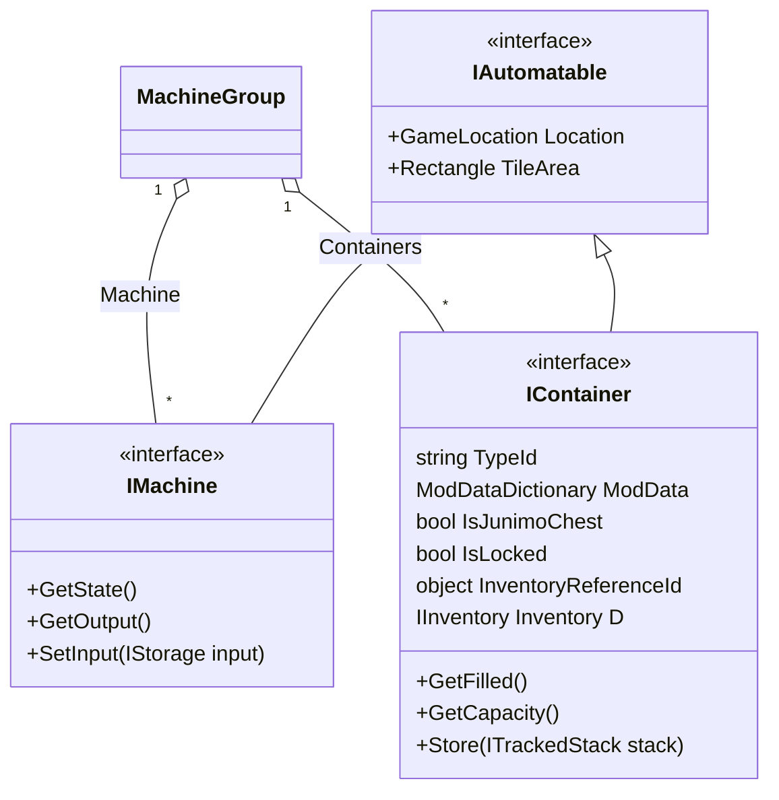
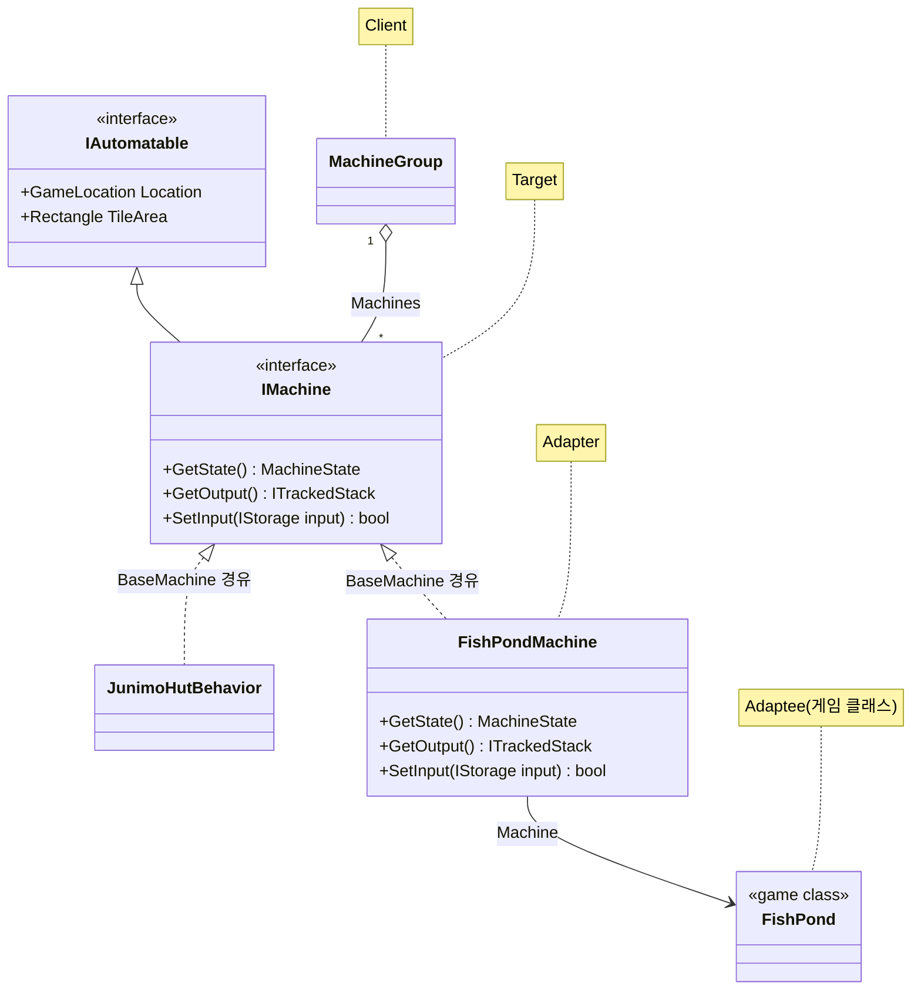
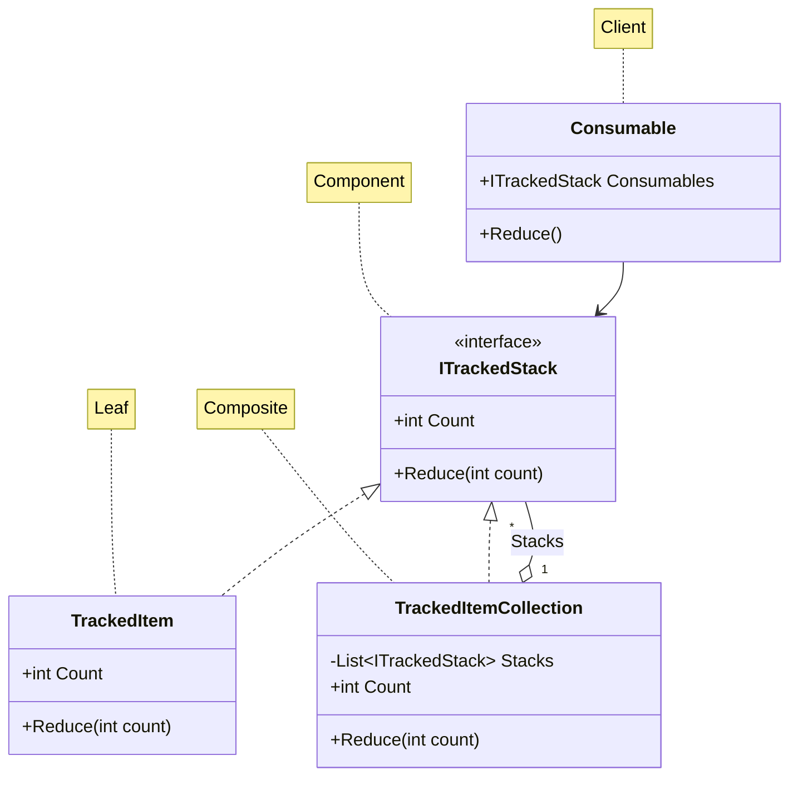

# 소프트웨어요구분석및디자인

- 해당 과목의 팀프로젝트로 특정 프로젝트의 클래스 구조를 분석
- 분석한 클래스 구조로 디자인패턴을 클래스 다이어그램으로 그리는 팀프로젝트.
- 해당 프로젝트의 주제는 스타듀벨리의 모드인 Automate모드로 선정함.

---

## UML

### 최상위 클래스 분석

---

### Adapter 패턴

---

### Composite 패턴

